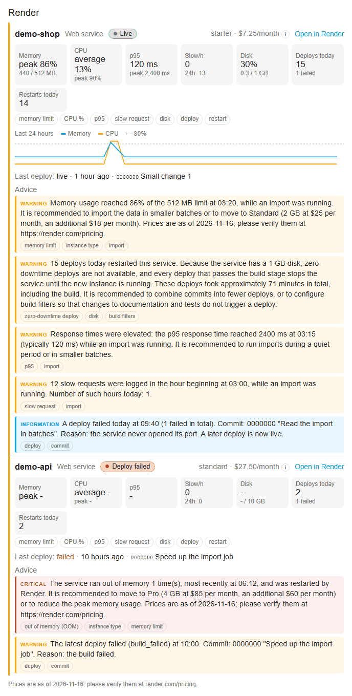
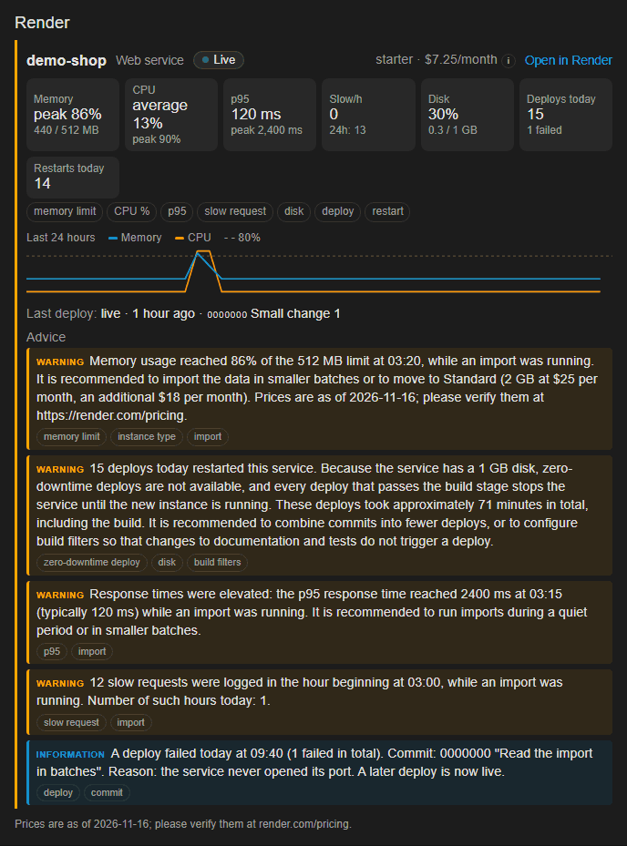
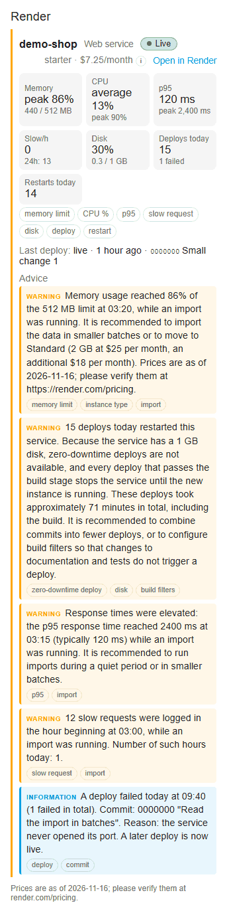

# Render Monitor

Render Monitor is a Home Assistant integration and dashboard card for
[Render](https://render.com) services. It reads the status, deploys, restarts, memory, CPU,
response times, slow requests, disk usage and monthly cost of each service, and provides advice
based on fixed rules. No AI is involved: every rule and threshold is documented below.

The integration and the card are in English only, regardless of the Home Assistant language.



The screenshots show invented test data (`demo-shop`, `demo-api`) and are produced from the
card's browser tests.

## Read-only

Render API keys **cannot be restricted to read-only access**. A key can also deploy, suspend
and delete services, and should therefore be protected like a password.

This integration performs read operations only:

- Every request is a `GET`. All network access passes through a single function, which calls
  nothing other than `session.get`.
- A test (`tests/test_read_only.py`) inspects the code and fails if `POST`, `PUT`, `PATCH`,
  `DELETE`, another HTTP client or any other means of calling Render is introduced.
- The key is stored in the Home Assistant config entry. It is sent only in the `Authorization`
  header to `https://api.render.com/v1`, and it is never written to the log or included in an
  error message. Diagnostics redact it.

## Installation

### HACS (custom repository)

1. In HACS, open the three-dot menu and select **Custom repositories**.
2. Add `https://github.com/niruse/render-monitor` with the type **Integration**.
3. Install **Render Monitor** and restart Home Assistant.

### Manual installation

Copy `custom_components/render_monitor` into the `config/custom_components/` folder of the
Home Assistant installation, then restart Home Assistant.

Home Assistant 2025.12 or later is required.

## Setup

Navigate to **Settings > Devices & services > Add integration > Render Monitor**.

| Step | Field | Notes |
|---|---|---|
| Connect | **API key** | Create a key in the Render dashboard under Account Settings > API Keys (<https://dashboard.render.com/u/settings#api-keys>). The key is validated immediately. |
| Workspace | **Workspace** | Shown only when the key has access to more than one workspace. If there is only one, it is selected automatically. Each workspace can be added once. |
| Services | **Services** | All services are selected by default. If all services remain selected, services added later are also monitored. |

**Options:** the monitored services, the **Refresh interval** (default 5 minutes, minimum 2)
and the **Metrics read interval** (default 15 minutes, minimum 5) can be changed. Metrics and
logs are retained between reads.

If Render later rejects the key, Home Assistant requests a new one. The new key must have access
to the same workspace.

### API usage

Render permits 400 API requests per minute, of which only 30 per minute may be log requests.
Each refresh reads:

- the service list, once;
- for each service, its deploys, the events of the last 24 hours, and its instances.

Each metrics read additionally reads:

- for each service, up to 8 metric series;
- two log searches covering all web services together: one for lines containing `slow:` and
  one for lines containing `import`.

The client also enforces its own limit of at most 300 requests and 20 log requests per minute.
When a large workspace would exceed this limit, the client waits rather than sending a burst of
requests. If Render nevertheless responds with HTTP 429, the client waits for the period given in
`Retry-After` and retries up to 3 times. The setup dialog does not wait; it reports the rate
limit immediately.

## Entities

Each service is represented by one device with the following entities:

| Entity | Unit | For | State / attributes |
|---|---|---|---|
| Status | - | all | `live`, `deploying`, `deploy_failed`, `suspended` or `not_deployed`. Attributes: type, plan, region, instances, suspenders, read errors. |
| Last deploy | timestamp | all | The time at which it finished. Attributes: status, trigger, short commit, message, created and finished times, duration, failure reason. |
| Deploys today | count | all | Attribute: the number of failed deploys. |
| Restarts today | count | not static sites or cron jobs | New instances today, derived from deploys, crashes, restarts and instance ids observed between polls. Attribute: the breakdown. |
| Memory peak (24 h) | % of the limit | not static sites or cron jobs | Attributes: peak MB, limit MB, when, and a chart series (not recorded). |
| CPU average / CPU peak (24 h) | % of the limit | not static sites or cron jobs | The average also has a chart series (not recorded). |
| Response time p95 | ms | web services | The latest p95. Attributes: peak, when, median. |
| Slow requests | requests/h | web services | `slow:` log lines in the last hour. Attributes: 24 h total, per hour (not recorded), and whether the log search was cut short. |
| Disk used | % | services with a disk | Attributes: used GB, size GB. |
| Monthly cost | USD | all | From the price table below. While a service is suspended, only its disk counts. Attributes: plan, instances, disk, price date. |
| Advice | count | all | The number of advice items. Attributes: the items (`severity`, `code`, `text_key`, `values`) and their English texts (not recorded). |
| Needs attention | problem | all | On when there is critical or warning advice, or when the latest deploy failed. |

Large attributes (chart series, the hourly table and the advice list) are excluded from the
recorder so that they do not fill the database.

### Log lines

The slow-request and import advice depends on the application writing log lines that contain
`slow:` (for a slow request) or `import` (for a data import job). If the application writes
neither, that advice is not produced.

## Advice rules

Every rule is a pure function in `custom_components/render_monitor/advice.py` and is covered by
unit tests. The advice texts are in English and are kept in
`custom_components/render_monitor/www/advice_texts.json`.

| Advice | Condition | Content |
|---|---|---|
| **Memory** (warning) | The memory peak reached **80%** or more of the limit in the last 24 hours. | The peak and the time at which it occurred. It names the next instance type with more memory and at least the same CPU, together with its price and the price difference. If an import was running at that time, it recommends importing in smaller batches. |
| **Out of memory** (critical) | At least one out-of-memory termination in the last 24 hours. | The number of terminations, the time of the most recent one, and the next instance type. |
| **Failed deploy** (warning) | The latest deploy failed, or a deploy failed today and no later deploy has gone live. | The commit, its message, and the reason (for example: the build failed, the service ran out of memory, the port was never opened, the start timed out, the health check failed, or the application exited with an error). |
| **Failed deploy, recovered** (information) | A deploy failed today and a later deploy is live. | The same details. |
| **Many deploys on a service with a disk** (warning) | **5 or more** deploys today passed the build stage on a service with a disk. | A service with a disk cannot use zero-downtime deploys, so each such deploy stops the service. It recommends combining commits or configuring build filters, and states the total duration of those deploys. |
| **Response time spike** (warning, or information if the cause is unknown) | A p95 value of **1000 ms or more** and at least **2x** the median of the day. Spikes within 30 minutes of each other count as one. | Whether an import, a deploy, both or neither was running at that time (within **15 minutes**). |
| **Slow request spike** (warning, or information if the cause is unknown) | An hour with **5 or more** `slow:` lines and at least **3x** the median hour. | The same cause check. If the log search was cut short, only the hours it fully covered are counted, and at least 6 such hours are required. |
| **Disk** (warning; critical at 95%) | The disk is **80%** full or more. | It recommends increasing the size by 1.5x and states the additional monthly cost. |
| **Suspended** (information) | The service is suspended. | Who suspended the service, its current cost (only a disk is billed) and its cost when running. |
| **Idle** (information) | A paid web service received no requests in 24 hours. | Its monthly cost, with a recommendation to suspend it or to move it to a smaller instance type. |

## Dashboard card

The integration bundles the card and loads it automatically, so no dashboard resource needs to
be added. Add the card from the card picker (**Render Monitor**) or in YAML:

```yaml
type: custom:render-monitor-card
# every option is optional:
title: Render            # "" hides the title
services: [demo-api]     # service names, in this order; omit to show all services
show_chart: true         # memory/CPU over 24 h
show_advice: true
```

Each service is shown in one block containing:

- a status chip;
- the plan and monthly price;
- a memory/CPU chart for the last 24 hours;
- p95 and slow requests;
- disk use;
- the last deploy;
- deploys and restarts today;
- the advice list.

Each term (p95, OOM, zero-downtime deploy and others) has an information button with a short
explanation. Selecting a value opens its history.

The card is displayed in English, left to right, regardless of the Home Assistant language. Its
colours follow the Home Assistant theme, light or dark. It reads only Home Assistant states and
never contacts Render.

| Dark theme | Phone width |
|---|---|
|  |  |

## Prices

The monthly cost and the advice are based on the following fixed table of Render prices.
**Prices are as of 2026-11-16.** Please verify them at <https://render.com/pricing> before
acting on them.

| Instance type | CPU | RAM | USD / month |
|---|---|---|---|
| Free | 0.1 | 512 MB | 0 |
| Starter | 0.5 | 512 MB | 7 |
| Standard | 1 | 2 GB | 25 |
| Pro | 2 | 4 GB | 85 |
| 2 CPU / 8 GB | 2 | 8 GB | 135 |
| Pro Plus | 4 | 8 GB | 175 |
| Pro Max | 4 | 16 GB | 225 |
| Pro Ultra | 8 | 32 GB | 450 |
| Persistent disk | | | 0.25 per GB |

The cost is calculated as follows:

- A service costs the number of instances x the price of its instance type, plus its disk.
- Static sites cost $0.
- Cron jobs are billed by run time and therefore have no price here.
- A plan that is not listed in the table shows no price.
- The API identifier of the 2 CPU / 8 GB type is not confirmed, so the advice refers to it by
  CPU and RAM.

## Privacy

- **Network access:** the integration communicates only with `api.render.com`, using the
  configured key, and only reads. The card communicates only with Home Assistant.
- **Diagnostics:** downloaded diagnostics exclude the key, the workspace id and name, service
  names and ids, URLs and commit messages. Services appear as `service_1`, `service_2` and so
  on.
- **Errors:** error texts shown on entities contain shortened Render ids (`srv-…`).
- **Test data:** all test data in this repository is invented (`demo-api`, `demo-shop`,
  `example.com`, `srv-0000…`).

## Development

```bash
pip install -r requirements_test.txt
python -m pytest -q tests -p no:logging

# the card in Chromium on a fake hass (tests_card/card_hass.json)
pip install -r requirements_card.txt
python -m playwright install chromium
python -m pytest -q tests_card
```

`tests_card/card_hass.json` is generated from the integration's own entity states, and
`tests/test_card_fixture.py` fails when it is out of date. To update it, run that test with
`RENDER_MONITOR_WRITE_CARD_FIXTURE=1`. To save card screenshots while the browser tests run,
set `RENDER_MONITOR_CARD_SHOTS=<folder>`.

## License

MIT

